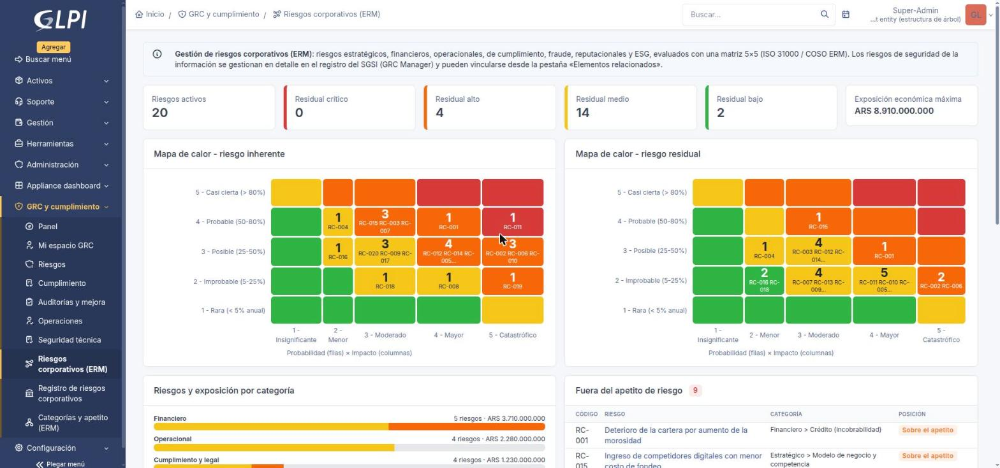

# ERM - Enterprise Risk Management for GLPI

 Enterprise risk register for **GLPI 12**, based on **ISO 31000** and **COSO ERM**.
Manage strategic, financial, operational, compliance, fraud, reputational and ESG risks next to your IT and
ISMS data, with optional integration with [GLPI GRC Manager](https://github.com/parime/glpi-iso27001-management).

> Status: **beta**. Available in English, Spanish (Argentina) and Spanish (Spain).



## Features

- **Configurable risk taxonomy** (category tree) with **risk appetite, tolerance** and appetite statement per
  category, inherited by sub-categories.
- **Risk register**: causes, consequences, owner and responsible group, **5x5 inherent and residual assessment**,
  existing controls and their effectiveness, **economic impact** (min/max), velocity and trend.
- Levels: 1-4 low, 5-9 medium, 10-16 high, 20-25 critical; automatic position against appetite/tolerance.
- **Treatment plans** (owner, due date, cost, status, overdue highlight).
- **Key Risk Indicators (KRI)** with warning/critical thresholds, direction and history chart.
- **Loss event database**: losses, near misses and gains linked with risks and with tickets, problems and changes.
  The loss history **suggests the probability and impact** of each risk (annual frequency over 3 years and largest
  loss against the entity's economic impact criteria) and flags underestimated risks.
- **Target risk, periodic reviews and treatment effectiveness**: every review keeps a snapshot of the assessment
  (evolution chart); the plugin flags treatment plans that finished without reaching the target.
- **E-mail notifications**: notice to the owner of a new risk and to the responsible of a new action, and a daily
  digest of overdue actions and reviews, KRIs in alert and risks above appetite or tolerance.
- **Formal risk acceptance with segregation of duties and validity**: only profiles with the acceptance right can
  accept, never the risk owner; who and when are recorded automatically; acceptances expire and must be renewed.
- **Quantitative analysis**: expected annual loss and Monte Carlo simulation from the loss history.
- **Automatic KRIs** from GLPI saved searches, and **ISMS control test results** (GRC Manager) on each risk.
- **Related items**: link corporate risks with GRC Manager risks, business processes, controls, objectives and
  obligations, and with suppliers, contracts, appliances, computers, projects, groups and changes. A reverse tab
  "Corporate risks" is added to those objects.
- **Dashboard**: inherent and residual heat maps, exposure per category, risks above appetite, top residual
  risks, overdue actions and KRIs in alert. **Every figure is clickable** and opens the risks behind it.
- **Action plan register** searchable across all risks, and a personal **"My ERM workspace"** (my actions, the
  KRIs I measure, my risks and reviews).
- **AI governance (ISO/IEC 42001, EU AI Act)**: inventory of AI systems, impact assessments with approval by
  someone other than the author, AI risk category and governance gaps on the dashboard.
- **Risk reports from the staff** from the simplified interface, reviewed and turned into loss events or risks.
- **Ready-to-assign role profiles** (Risk manager, Risk owner, Treatment responsible, Risk Committee, Internal
  audit) without access to the inventory.
- **Board report (PDF)** with quarterly snapshots and comparison with the previous quarter, and an **integrated
  risk map** (corporate + ISMS + supplier risks when GRC Manager is present).
- **Role based access** (per profile and entity): see all / see own risks, update all / update own, treatment,
  taxonomy & appetite, acceptance. Search, dashboard and selectors are filtered accordingly.
- **Multi-company**: per entity risk code prefix and appetite/tolerance overrides (inherited by sub-entities), and a
  "risks by entity" dashboard for consultants managing several companies.
- Native GLPI features: entities, search engine, documents, notes, history, REST API (`GlpiPlugin\Erm\*`).

## Requirements

| Component | Version |
|---|---|
| GLPI | 12.0.x |
| PHP | 8.2 or later |
| GLPI GRC Manager | **optional**: ERM works on its own with its own top-level menu. When GRC Manager is active, ERM places its entries in its menu, links corporate risks with ISMS objects and adds ISMS and supplier risks to the integrated map and the Board report (read only) |

No third-party runtime libraries.

## Installation

```bash
cd /path/to/glpi/plugins
tar xjf glpi-erm-x.y.z.tar.bz2          # creates the "erm" directory
php ../bin/console plugin:install -u glpi erm
php ../bin/console plugin:activate erm
php ../bin/console cache:clear
```

Logged-in users must log in again (or switch profile) to see the new menu entries.
See the [administration guide](docs/guia-administracion.md), the [user manual](docs/manual-usuario.md), the
[quick guides by role](docs/guias-rapidas.md) and the [end-to-end case](docs/caso-completo.md) (Spanish).

## Development

Clone the repository inside `glpi/plugins/erm` of a GLPI 12 development instance, then:

```bash
composer install            # dev tools: PHP_CodeSniffer (PSR-12) and PHPStan
composer lint               # PSR-12
composer analyse            # PHPStan level 5 (uses the parent GLPI sources)
composer test               # PHPUnit unit tests
python3 tools/extract_locales.py && python3 tools/build_po.py   # refresh locales (requires Babel)
```

The same checks run in GitHub Actions on every push and pull request.

### Translations

Strings use the `erm` gettext domain. `tools/extract_locales.py` regenerates `locales/erm.pot`; translations live in
`tools/translations_es.py` (Spanish) and are compiled to `locales/*.po` / `*.mo` by `tools/build_po.py`.
New languages are welcome: add a `.po` file based on `locales/erm.pot`.

Contributions are welcome, see [CONTRIBUTING](CONTRIBUTING.md). Security issues: see [SECURITY](SECURITY.md).

## License

[GPL-3.0-or-later](LICENSE). Copyright (C) 2026 daniellopez6.

---

## Resumen en español

Registro de riesgos corporativos para GLPI 12 (ISO 31000 / COSO ERM): taxonomía configurable con apetito y
tolerancia, evaluación inherente y residual 5×5 con impacto económico, planes de tratamiento, indicadores clave
de riesgo, aceptación formal con segregación de funciones, permisos por rol (todos / propios) y tablero con
mapas de calor. Integración opcional con GLPI GRC Manager. Documentación:
[manual de usuario](docs/manual-usuario.md), [guías rápidas por rol](docs/guias-rapidas.md),
[caso de punta a punta](docs/caso-completo.md) y [guía de administración](docs/guia-administracion.md).
