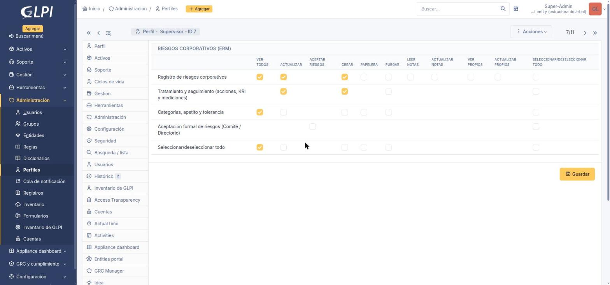
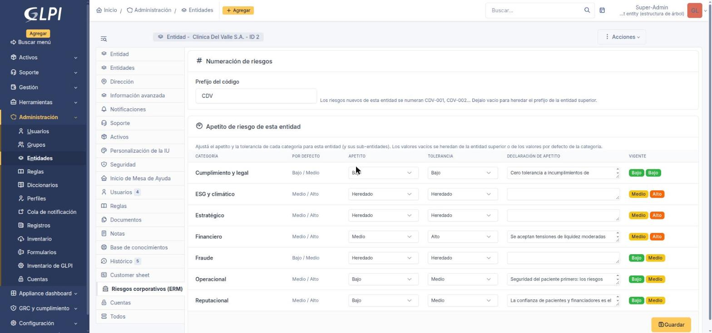
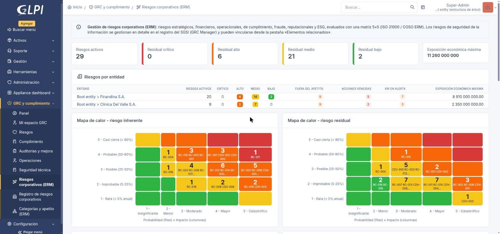

# Guía de administración - ERM (Gestión de Riesgos Corporativos)

Versión del plugin: 1.4.x · GLPI 12.0.x · PHP 8.2+

## 1. Instalación

1. Descargá el archivo de la versión (`glpi-erm-x.y.z.tar.bz2`) y descomprimilo en `glpi/plugins/`: debe quedar
   la carpeta `glpi/plugins/erm/` (el nombre de la carpeta no se puede cambiar).
2. Instalá y activá:
   ```bash
   cd /var/www/html/glpi
   sudo -u www-data php bin/console plugin:install -u glpi erm
   sudo -u www-data php bin/console plugin:activate erm
   sudo -u www-data php bin/console cache:clear
   ```
   También se puede hacer desde **Configuración → Complementos**.
3. La instalación crea las tablas `glpi_plugin_erm_*`, la taxonomía inicial de categorías con apetito y
   tolerancia (en el idioma del usuario que instala), las columnas por defecto del registro y los permisos con valores iniciales por perfil.
4. Los usuarios conectados deben **volver a iniciar sesión** (o cambiar de perfil) para ver el menú.

## 2. Actualización

1. Reemplazá la carpeta `glpi/plugins/erm/` por la nueva versión.
2. Ejecutá:
   ```bash
   sudo -u www-data php bin/console plugin:install -u glpi --force erm
   sudo -u www-data php bin/console plugin:activate erm
   sudo -u www-data php bin/console cache:clear
   ```
   La instalación es idempotente: crea lo que falta y **no modifica** permisos ni datos existentes.
3. Hacé un backup de la base de datos antes de cualquier actualización.

## 3. Permisos por rol

**Administración → Perfiles → (perfil) → pestaña "Riesgos corporativos (ERM)"**.



| Fila | Columnas | Efecto |
|---|---|---|
| **Registro de riesgos corporativos** (`plugin_erm`) | Ver todos · Ver propios · Actualizar · Actualizar propios · Crear · Papelera · Purgar · Leer/Actualizar notas | "Propios" limita la lista, el tablero, los selectores y el acceso directo a los riesgos donde el usuario es dueño, pertenece al área responsable o tiene una acción o KRI asignado. |
| **Tratamiento y seguimiento** (`plugin_erm_treatment`) | Crear · Actualizar · Purgar | Acciones, indicadores y mediciones de los riesgos que el usuario puede ver. El registro "Planes de acción" respeta la misma visibilidad: con "Ver propios", sólo las acciones de sus riesgos o asignadas al usuario. |
| **Categorías, apetito y tolerancia** (`plugin_erm_config`) | Ver todos · Actualizar · Crear · Papelera · Purgar | Taxonomía y apetito. La taxonomía se puede **consultar** también con permiso de lectura del registro. |
| **Aceptación formal de riesgos** (`plugin_erm_accept`) | Aceptar riesgos | Aceptar o revocar una aceptación. Nunca sobre un riesgo propio. Con sólo este permiso, el usuario edita decisión, estado, justificación y fechas de revisión. |

Sin ningún permiso, el usuario no ve el menú, el tablero, el registro ni la pestaña "Riesgos corporativos" en
otros objetos.

### Configuración sugerida

| Rol | Registro | Tratamiento | Categorías | Aceptación |
|---|---|---|---|---|
| Colaborador (autoservicio) | — | — | — | — |
| Dueño de riesgo | Ver propios + Actualizar propios | Crear + Actualizar | — | — |
| Gestor de riesgos / CRO | Todo | Todo | Todo | — |
| Comité de riesgos / Directorio | Ver todos + Leer notas | — | Ver + Actualizar | Aceptar |
| Auditoría interna | Ver todos + Leer notas | — | Ver | — |

Valores que asigna la instalación a los perfiles estándar: Super-Admin (todo, incluida la aceptación), Admin
(todo menos aceptar), Supervisor (ver, actualizar y crear), Technician (ver/actualizar propios y tratamiento),
Observer y Read-Only (ver todos).

## 4. Entidades y varias empresas

Cada riesgo pertenece a una entidad (con opción de visibilidad en sub-entidades). Los permisos se asignan por
entidad en **Usuarios → (usuario) → Autorizaciones**: un consultor puede gestionar varias empresas y el personal de
cada cliente sólo la suya.

En **Administración → Entidades → (entidad) → pestaña "Riesgos corporativos (ERM)"** (permiso "Categorías, apetito y
tolerancia") se configura por empresa:

- **Prefijo del código**: los riesgos nuevos se numeran `PREFIJO-001`, `PREFIJO-002`... de forma independiente en
  cada entidad. Vacío = hereda el de la entidad superior (por defecto `RC`). El código es único dentro de la entidad.
- **Apetito y tolerancia por categoría**: ajustan los valores por defecto de la taxonomía para esa empresa, con su
  propia declaración de apetito. Lo que se deja en "Heredado" toma el valor de la entidad superior o el de la
  categoría. La columna "Vigente" muestra el resultado.


- **Categorías propias**: una empresa puede tener subcategorías propias creándolas en su entidad (por ejemplo,
  "Habilitaciones sanitarias" para una clínica).

Cuando un usuario ve varias entidades a la vez, el tablero agrega la tabla **Riesgos por entidad** (riesgos por
nivel, fuera del apetito, acciones vencidas, KRI en alerta y exposición), con acceso al registro filtrado.



## 5. Integración con GLPI GRC Manager (opcional)

Si GRC Manager está activo, el plugin se ubica en su menú "GRC y cumplimiento" y permite vincular riesgos
corporativos con riesgos, procesos de negocio, controles, objetivos, obligaciones y riesgos de proveedores del
SGSI. No es un requisito: sin GRC Manager el plugin funciona y su menú aparece en **Gestión**.

## 6. API REST

Los objetos están disponibles en la API v1 de GLPI con los nombres de clase completos (codificados en la URL):
`GlpiPlugin\Erm\Risk`, `Category`, `Action`, `Indicator`, `IndicatorValue`, `Risk_Item`. La API respeta los mismos
permisos y validaciones que la interfaz. Ejemplo:

```
GET /api.php/v1/GlpiPlugin%5CErm%5CRisk?range=0-49
```

## 7. Desinstalación

**Configuración → Complementos → ERM → Desinstalar** (o `php bin/console plugin:uninstall erm`).
**Elimina todas las tablas y datos del plugin**, sus permisos, preferencias de visualización, vínculos de
documentos e historial. Hacé un backup antes.

## 8. Idiomas

El plugin está en inglés, español de Argentina (`es_AR`) y español de España (`es_ES`); se muestra en el idioma
de cada usuario. Para agregar un idioma, crear un `.po` a partir de `locales/erm.pot` y compilarlo a `.mo`.

## 9. Solución de problemas

| Síntoma | Causa y solución |
|---|---|
| No aparece el menú después de instalar | El menú se guarda en la sesión: cerrar sesión y volver a entrar. |
| Cambios de pantalla no se ven después de actualizar | Ejecutar `php bin/console cache:clear` (plantillas compiladas). |
| "No tenés permiso para realizar esta acción" | Revisar la matriz del perfil y la entidad del usuario; con "Ver propios" sólo se accede a riesgos propios. |
| Un usuario del Comité no puede aceptar | Necesita el permiso "Aceptar riesgos", la decisión debe ser "Aceptar" y no puede ser el dueño del riesgo. |
