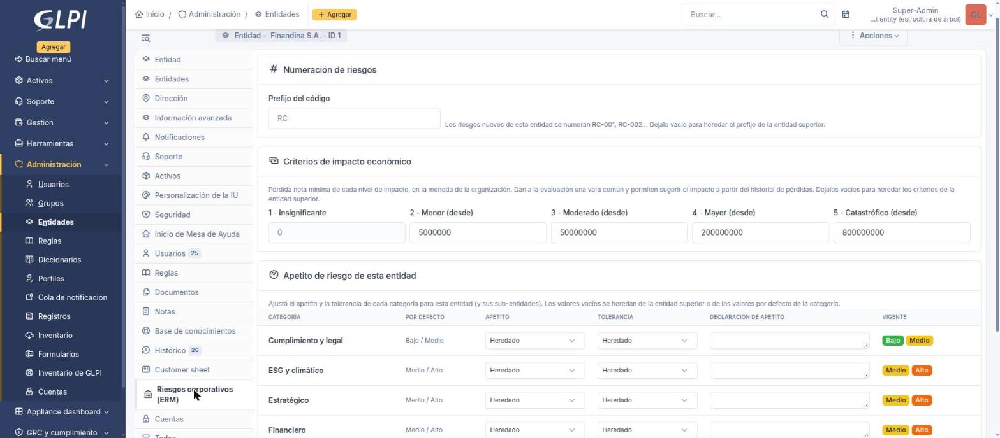

# Guía de administración - ERM (Gestión de Riesgos Corporativos)

Versión del plugin: 2.0.x · GLPI 12.0.x · PHP 8.2+

## 1. Instalación

1. Descargá el archivo de la versión (`glpi-erm-x.y.z.tar.bz2`) y descomprimilo en `glpi/plugins/`: debe quedar
   la carpeta `glpi/plugins/erm/` (el nombre de la carpeta no se puede cambiar).
2. Instalá y activá:
   ```bash
   cd /var/www/html/glpi
   sudo -u www-data php bin/console plugin:install -u glpi erm
   sudo -u www-data php bin/console plugin:activate erm
   sudo -u www-data php bin/console cache:clear
   ```
   También se puede hacer desde **Configuración → Complementos**.
3. La instalación crea las tablas `glpi_plugin_erm_*`, la taxonomía inicial de categorías con apetito y
   tolerancia (en el idioma del usuario que instala), las columnas por defecto del registro y los permisos con valores iniciales por perfil.
4. Los usuarios conectados deben **volver a iniciar sesión** (o cambiar de perfil) para ver el menú.

## 2. Actualización

1. Reemplazá la carpeta `glpi/plugins/erm/` por la nueva versión.
2. Ejecutá:
   ```bash
   sudo -u www-data php bin/console plugin:install -u glpi --force erm
   sudo -u www-data php bin/console plugin:activate erm
   sudo -u www-data php bin/console cache:clear
   ```
   La instalación es idempotente: crea lo que falta y **no modifica** permisos ni datos existentes.
3. Hacé un backup de la base de datos antes de cualquier actualización.

## 3. Permisos por rol

**Administración → Perfiles → (perfil) → pestaña "Riesgos corporativos (ERM)"**.


| Fila | Columnas | Efecto |
|---|---|---|
| **Registro de riesgos corporativos** (`plugin_erm`) | Ver todos · Ver propios · Actualizar · Actualizar propios · Crear · Papelera · Purgar · Leer/Actualizar notas | "Propios" limita la lista, el tablero, los selectores y el acceso directo a los riesgos donde el usuario es dueño, pertenece al área responsable o tiene una acción o KRI asignado. |
| **Tratamiento y seguimiento** (`plugin_erm_treatment`) | Crear · Actualizar · Purgar | Acciones, indicadores y mediciones de los riesgos que el usuario puede ver. El registro "Planes de acción" respeta la misma visibilidad: con "Ver propios", sólo las acciones de sus riesgos o asignadas al usuario. |
| **Categorías, apetito y tolerancia** (`plugin_erm_config`) | Ver todos · Actualizar · Crear · Papelera · Purgar | Taxonomía y apetito. La taxonomía se puede **consultar** también con permiso de lectura del registro. |
| **Eventos de pérdida e incidentes** (`plugin_erm_event`) | Ver todos · Actualizar · Crear · Papelera · Purgar · Leer/Actualizar notas | Registrar eventos, vincularlos con riesgos y tickets. Para que la mesa de ayuda pueda reportar eventos alcanza con "Ver todos + Crear". |
| **Sistemas de IA y evaluaciones de impacto** (`plugin_erm_ai`) | Ver · Actualizar · Crear · Papelera · Purgar · Notas · **Aprobar evaluaciones** | Inventario de IA y evaluaciones de impacto. "Aprobar" permite aprobar o rechazar evaluaciones enviadas, nunca las propias. |
| **Aceptación formal de riesgos** (`plugin_erm_accept`) | Aceptar riesgos | Aceptar o revocar una aceptación. Nunca sobre un riesgo propio. Con sólo este permiso, el usuario edita decisión, estado, justificación y fechas de revisión. |

Sin ningún permiso, el usuario no ve el menú, el tablero, el registro ni la pestaña "Riesgos corporativos" en
otros objetos.

### Perfiles listos para asignar

La instalación crea seis perfiles de **interfaz estándar sin acceso al inventario** (equipos, software, redes,
etc.): sólo gestión de riesgos y lo mínimo de GLPI para cada rol. Se asignan en **Administración → Usuarios →
(usuario) → Autorizaciones**, por entidad.

| Perfil | Para quién | Registro | Tratamiento | Categorías | Aceptación | Eventos | GLPI |
|---|---|---|---|---|---|---|---|
| ERM - Gestor de riesgos | Responsable del proceso (CRO) | Todo + notas | Todo | Todo | — | Todo + notas | Documentos, tickets/problemas/cambios (lectura), entidades, usuarios y grupos (lectura) |
| ERM - Dueño de riesgo | Gerentes dueños de riesgos | Ver y actualizar propios | Crear + Actualizar | — | — | Ver + Crear | Documentos, tickets/problemas/cambios (lectura) |
| ERM - Responsable de tratamiento | Quien ejecuta acciones o mide KRI | Ver propios | Crear + Actualizar | — | — | Ver + Crear | Documentos |
| ERM - Comité de riesgos | Directorio / Comité | Ver todos + notas | — | Ver + Actualizar | Aceptar | Ver | Documentos (lectura) |
| ERM - Responsable de IA | Quien mantiene el inventario de IA | Ver y actualizar propios | Crear + Actualizar | — | — | Ver + Crear | Documentos; IA: crear, actualizar y notas (no aprueba) |
| ERM - Auditoría interna | Auditores | Ver todos + notas | — | Ver | — | Ver + notas | Documentos y tickets/problemas/cambios (lectura) |

En IA: el Gestor tiene todo menos aprobar, el Comité ve y **aprueba evaluaciones**, Auditoría lee. Todos incluyen base de conocimientos, preferencias personales y cambio de contraseña. Cada perfil se crea **una
sola vez** (se reconoce por una marca `[erm:...]` en el comentario, aunque se le cambie el nombre) y la instalación
**nunca lo modifica**: se puede adaptar libremente. Si se borra, se vuelve a crear en la próxima actualización;
para evitarlo, conservá la marca en otro perfil. La desinstalación no borra los perfiles (pueden tener usuarios
asignados).

### Configuración sugerida

| Rol | Registro | Tratamiento | Categorías | Aceptación | Eventos |
|---|---|---|---|---|---|
| Colaborador (autoservicio) | — | — | — | — | — |
| Mesa de ayuda / técnicos | Ver propios | Crear + Actualizar | — | — | Ver + Crear |
| Dueño de riesgo | Ver propios + Actualizar propios | Crear + Actualizar | — | — | Ver + Crear |
| Gestor de riesgos / CRO | Todo | Todo | Todo | — | Todo |
| Comité de riesgos / Directorio | Ver todos + Leer notas | — | Ver + Actualizar | Aceptar | Ver |
| Auditoría interna | Ver todos + Leer notas | — | Ver | — | Ver + Leer notas |

Valores que asigna la instalación a los perfiles estándar: Super-Admin (todo, incluida la aceptación), Admin
(todo menos aceptar), Supervisor (ver, actualizar y crear), Technician (ver/actualizar propios y tratamiento),
Observer y Read-Only (ver todos).

## 4. Entidades y varias empresas

Cada riesgo pertenece a una entidad (con opción de visibilidad en sub-entidades). Los permisos se asignan por
entidad en **Usuarios → (usuario) → Autorizaciones**: un consultor puede gestionar varias empresas y el personal de
cada cliente sólo la suya.

En **Administración → Entidades → (entidad) → pestaña "Riesgos corporativos (ERM)"** (permiso "Categorías, apetito y
tolerancia") se configura por empresa:

- **Prefijo del código**: los riesgos nuevos se numeran `PREFIJO-001`, `PREFIJO-002`... de forma independiente en
  cada entidad. Vacío = hereda el de la entidad superior (por defecto `RC`). El código es único dentro de la entidad.
- **Apetito y tolerancia por categoría**: ajustan los valores por defecto de la taxonomía para esa empresa, con su
  propia declaración de apetito. Lo que se deja en "Heredado" toma el valor de la entidad superior o el de la
  categoría. La columna "Vigente" muestra el resultado.


- **Criterios de impacto económico**: pérdida neta mínima de cada nivel de impacto (Menor, Moderado, Mayor,
  Catastrófico) en la moneda de la organización. Dan una vara común a la evaluación y permiten sugerir el impacto
  desde el historial de pérdidas. Vacíos = se heredan de la entidad superior. Los montos deben crecer con el nivel.



- **Categorías propias**: una empresa puede tener subcategorías propias creándolas en su entidad (por ejemplo,
  "Habilitaciones sanitarias" para una clínica).

Cuando un usuario ve varias entidades a la vez, el tablero agrega la tabla **Riesgos por entidad** (riesgos por
nivel, fuera del apetito, acciones vencidas, KRI en alerta y exposición), con acceso al registro filtrado.


## 5. Notificaciones por correo

La instalación crea cuatro notificaciones del tipo **Riesgo corporativo** (Configuración → Notificaciones →
Notificaciones), con su plantilla, y la acción automática **ermalerts** (Configuración → Acciones automáticas,
diaria entre las 6 y las 8):

| Notificación | Cuándo | Destinatarios por defecto |
|---|---|---|
| Alertas de riesgos corporativos | Resumen diario por riesgo (ermalerts) | Dueño del riesgo, responsables de las acciones y de los KRI alertados |
| Se te asignó un riesgo corporativo | Al crear el riesgo o cambiar el dueño | Dueño del riesgo |
| Se te asignó una acción de tratamiento | Al crear la acción o cambiar el responsable | Responsable de la acción |
| Se cumplió una acción de tratamiento de tu riesgo | Al marcar una acción como Realizada (si es la última, informa si el riesgo alcanzó el objetivo) | Dueño del riesgo |

También está disponible el destinatario "Área responsable del riesgo". Los textos se crean en el idioma de quien
instala; se pueden editar en las plantillas. La misma alerta se repite como máximo una vez por semana
(tabla `glpi_plugin_erm_alerts`).

Para que se envíen:

1. **Configuración → Notificaciones**: activar el seguimiento por notificaciones y por correo, y configurar el
   servidor SMTP (pestaña Configuración de correo electrónico).
2. **Configuración → General → URL de la aplicación**: la dirección real de GLPI (se usa en los enlaces del
   correo).
3. El cron de GLPI debe estar activo (`php bin/console glpi:cron` cada minuto), porque ermalerts corre en modo
   externo.

## 6. Reportes del personal

La interfaz simplificada (autoservicio) muestra la entrada **Complementos → ERM** para reportar riesgos e incidentes.
Cualquier usuario autenticado puede reportar (en su entidad activa) y ver sus propios reportes. Los revisan quienes
tienen el permiso de crear eventos de pérdida o riesgos.

## 7. Integración con GLPI GRC Manager (opcional)

ERM es **independiente**: se instala y funciona sin GRC Manager, con su propio menú **Riesgos corporativos (ERM)**.
Si GRC Manager está activo:

- las entradas de ERM se ubican dentro del menú "GRC y cumplimiento";
- los riesgos corporativos se pueden vincular con riesgos, procesos de negocio, controles, objetivos, obligaciones y
  riesgos de proveedores del SGSI;
- el **mapa integral** y el **informe de Directorio** suman los riesgos del SGSI y de proveedores, sólo lectura y
  sólo para usuarios con permiso de lectura en GRC Manager.

ERM nunca escribe en las tablas de GRC Manager.

La acción automática **ermkri** (diaria, entre la 1 y las 5) mide los KRI automáticos cuya próxima medición
corresponde, ejecutando su búsqueda guardada con los permisos del dueño de la búsqueda (igual que las alertas de
búsquedas guardadas de GLPI).

La acción automática **ermsnapshot** (diaria, entre las 2 y las 5) toma la foto trimestral del perfil de riesgos
la primera vez que corre en cada trimestre.

## 8. API REST

Los objetos están disponibles en la API v1 de GLPI con los nombres de clase completos (codificados en la URL):
`GlpiPlugin\Erm\Risk`, `Category`, `Action`, `Indicator`, `IndicatorValue`, `Risk_Item`. La API respeta los mismos
permisos y validaciones que la interfaz. Ejemplo:

```
GET /api.php/v1/GlpiPlugin%5CErm%5CRisk?range=0-49
```

## 9. Desinstalación

**Configuración → Complementos → ERM → Desinstalar** (o `php bin/console plugin:uninstall erm`).
**Elimina todas las tablas y datos del plugin**, sus notificaciones y acción automática, sus permisos, preferencias de visualización, vínculos de
documentos e historial. Hacé un backup antes.

## 10. Idiomas

El plugin está en inglés, español de Argentina (`es_AR`) y español de España (`es_ES`); se muestra en el idioma
de cada usuario. Para agregar un idioma, crear un `.po` a partir de `locales/erm.pot` y compilarlo a `.mo`.

## 11. Solución de problemas

| Síntoma | Causa y solución |
|---|---|
| No aparece el menú después de instalar | El menú se guarda en la sesión: cerrar sesión y volver a entrar. |
| Cambios de pantalla no se ven después de actualizar | Ejecutar `php bin/console cache:clear` (plantillas compiladas). |
| "No tenés permiso para realizar esta acción" | Revisar la matriz del perfil y la entidad del usuario; con "Ver propios" sólo se accede a riesgos propios. |
| No llegan los correos | Revisar que las notificaciones y el correo estén activos, el SMTP, la cola (Administración → Cola de notificaciones), que el usuario tenga correo y perfil en la entidad del riesgo, y que el cron de GLPI corra. |
| Un usuario del Comité no puede aceptar | Necesita el permiso "Aceptar riesgos", la decisión debe ser "Aceptar" y no puede ser el dueño del riesgo. |
