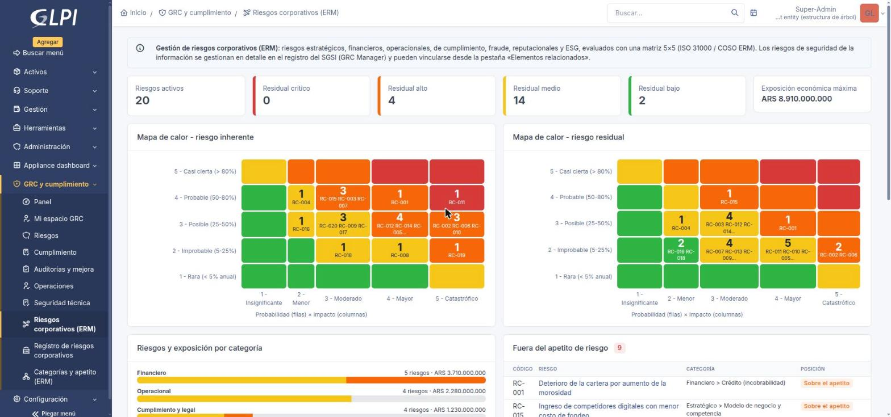

# Manual de usuario - ERM (Gestión de Riesgos Corporativos)

Versión del plugin: 1.2.x · GLPI 12

Este manual explica cómo usar el registro de riesgos corporativos día a día. La instalación y los permisos
están en la [guía de administración](guia-administracion.md).

## 1. Conceptos

| Concepto | Qué significa en el plugin |
|---|---|
| **Riesgo corporativo** | Evento incierto que puede afectar los objetivos de la organización (no sólo de TI). |
| **Categoría** | Clasificación jerárquica: Estratégico, Financiero, Operacional, Cumplimiento y legal, Fraude, Reputacional, ESG y climático. Se crea al instalar en el idioma de quien instala y se puede adaptar. |
| **Riesgo inherente** | Nivel del riesgo **sin** considerar los controles existentes. |
| **Riesgo residual** | Nivel del riesgo **después** de los controles existentes. Es el que se compara con el apetito. |
| **Apetito** | Nivel residual máximo que la organización **desea** asumir en una categoría. |
| **Tolerancia** | Nivel residual máximo **admisible**. Superarlo exige acción inmediata. |
| **Riesgo propio** | Un riesgo del que sos dueño, de tu área, o donde tenés una acción o un indicador asignado. |

## 2. Dónde está

Menú **GRC y cumplimiento** (o **Gestión** si GRC Manager no está instalado):

- **Riesgos corporativos (ERM)**: tablero.
- **Registro de riesgos corporativos**: lista y búsqueda.
- **Categorías y apetito (ERM)**: taxonomía, apetito y tolerancia.

Lo que ves depende de tu perfil: con "ver propios" sólo aparecen tus riesgos, y un aviso lo indica en el tablero.

## 3. Escalas de evaluación (matriz 5×5)

**Probabilidad**: 1 Rara (< 5% anual) · 2 Improbable (5-25%) · 3 Posible (25-50%) · 4 Probable (50-80%) ·
5 Casi cierta (> 80%).

**Impacto**: 1 Insignificante · 2 Menor · 3 Moderado · 4 Mayor · 5 Catastrófico. Cada organización define los
umbrales económicos de cada nivel en su metodología (por ejemplo, en la declaración de apetito); considerá también el
impacto legal, reputacional y operativo, no sólo el económico. Los importes se cargan en la moneda de la organización.

**Nivel** = probabilidad × impacto: **1-4 Bajo**, **5-9 Medio**, **10-16 Alto**, **20-25 Crítico**.

## 4. Registrar un riesgo

1. **Registro de riesgos corporativos → Agregar**.
2. **Identificación**: nombre del riesgo (redactalo como evento: "Deterioro de la cartera por…"), categoría,
   dueño, área responsable, descripción, **causas** y **consecuencias**. El código (RC-001…) se asigna solo.
3. **Evaluación inherente**: probabilidad e impacto sin controles. El nivel se calcula al guardar. Completá la
   velocidad de materialización y el impacto económico mínimo y máximo (acepta `1.500.000,50` o `1500000.5`, en la moneda de la organización).
4. **Controles existentes y riesgo residual**: describí los controles, su eficacia y la tendencia; luego
   probabilidad e impacto residuales. Se muestra la **posición frente al apetito** de la categoría.
5. **Tratamiento**: elegí la decisión (Mitigar, Transferir, Evitar, Aceptar), el estado, la justificación y las
   fechas de revisión.
6. **Guardar**.

## 5. Plan de tratamiento

Pestaña **Plan de tratamiento** del riesgo:

- **Agregar**: descripción, responsable, vencimiento y costo estimado.
- **Actualizar**: cambiá el estado (Planificada, En curso, Realizada, Cancelada). Al marcar "Realizada" se
  completa la fecha si no la indicaste.
- Las acciones vencidas se resaltan en rojo y aparecen en el tablero.
- Un riesgo a **mitigar o transferir no se puede cerrar** sin al menos una acción.

## 6. Indicadores clave de riesgo (KRI)

Pestaña **Indicadores (KRI)**:

1. **Nuevo indicador**: nombre, unidad, sentido ("mayor es peor" o "menor es peor"), umbral de alerta, umbral
   crítico y frecuencia.
2. **Registrar valor**: fecha, valor y comentario. El gráfico muestra las últimas 12 mediciones en verde
   (normal), naranja (alerta) o rojo (crítico).

Los KRI en alerta o críticos aparecen en el tablero.

## 7. Aceptación formal de un riesgo

Aceptar un riesgo es una decisión de la Dirección o del Comité de riesgos:

1. El dueño propone la decisión **Aceptar** con su justificación.
2. Un usuario con el permiso **Aceptación de riesgos** abre el riesgo, deja la decisión "Aceptar", cambia el
   estado a **Aceptado** y guarda.
3. El sistema registra automáticamente **quién y cuándo** aceptó.

Reglas: el **dueño no puede aceptar su propio riesgo**; sin el permiso, la opción "Aceptado" no aparece; revocar
una aceptación también requiere el permiso. El Comité sólo puede modificar la decisión, el estado, la
justificación y las fechas de revisión: la evaluación queda bloqueada.

## 8. Vincular con otros elementos

Pestaña **Elementos relacionados**: elegí el tipo (riesgo o proceso del SGSI, control, obligación, proveedor,
contrato, aplicación, equipo, proyecto, grupo, cambio) y el elemento. Desde esos objetos, la pestaña
**Riesgos corporativos** muestra el camino inverso. Ejemplo: el riesgo de ciberataque corporativo vinculado a los
riesgos de ransomware y phishing del SGSI.

## 9. Tablero

- **Indicadores** por nivel residual y exposición económica máxima total.
- **Mapas de calor** inherente y residual: cada celda muestra cuántos riesgos y sus códigos (pasá el mouse para
  verlos todos). Comparar ambos mapas muestra el efecto de los controles.
- **Riesgos y exposición por categoría**.
- **Fuera del apetito**: riesgos residuales sobre el apetito (naranja) o sobre la tolerancia (rojo).
- **Top 10 residuales**, **acciones vencidas** y **KRI en alerta**.

## 10. Categorías y apetito

**Categorías y apetito (ERM)** (requiere el permiso de configuración para modificar): cada categoría tiene
apetito, tolerancia y declaración de apetito. Si una subcategoría no los define, **hereda** los de la superior.
Cambiar el apetito actualiza inmediatamente la posición de todos los riesgos de esa categoría.

## 11. Buenas prácticas

- Revisá cada riesgo al menos una vez al año (campo "Próxima revisión") y siempre ante un cambio relevante.
- Un riesgo sobre la tolerancia debe tener un plan de tratamiento con fechas, o una aceptación formal justificada.
- Usá los KRI para anticipar: un indicador que se acerca al umbral de alerta es una señal para el dueño.
- Los riesgos de seguridad de la información se gestionan en detalle en el SGSI (GRC Manager); en el ERM,
  vinculalos a un riesgo corporativo agregado (por ejemplo, "Ciberataque con paralización del negocio").
