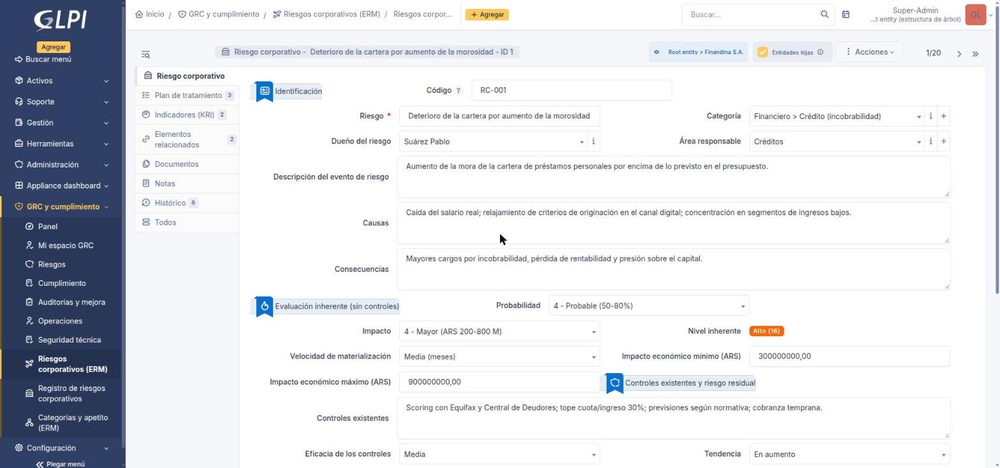
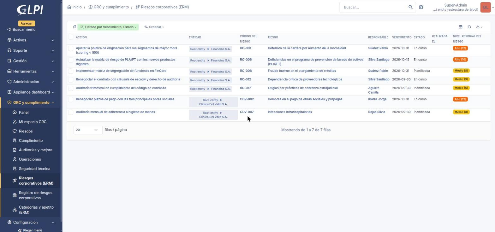
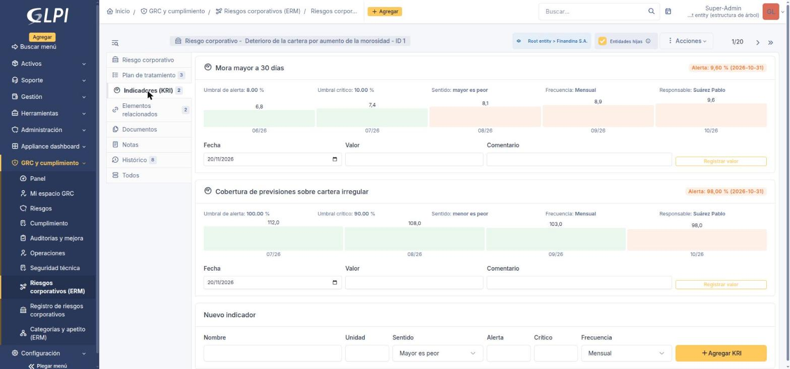
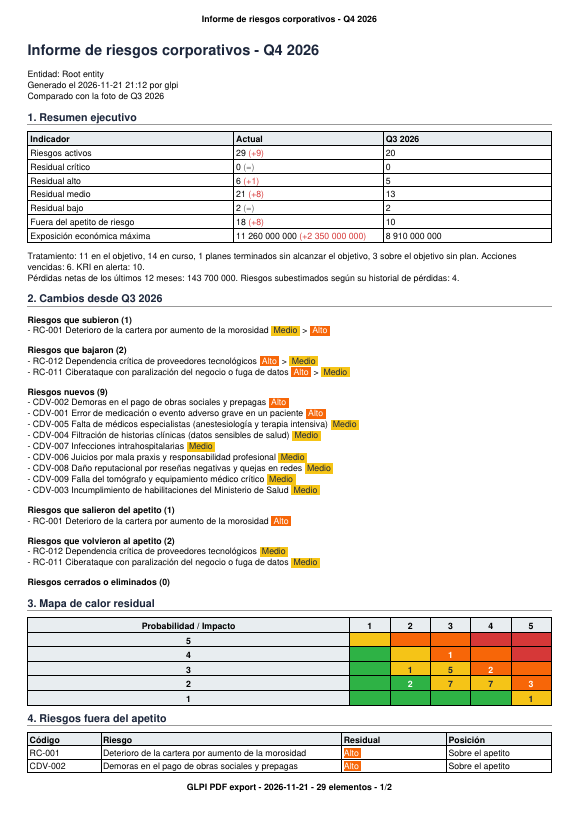
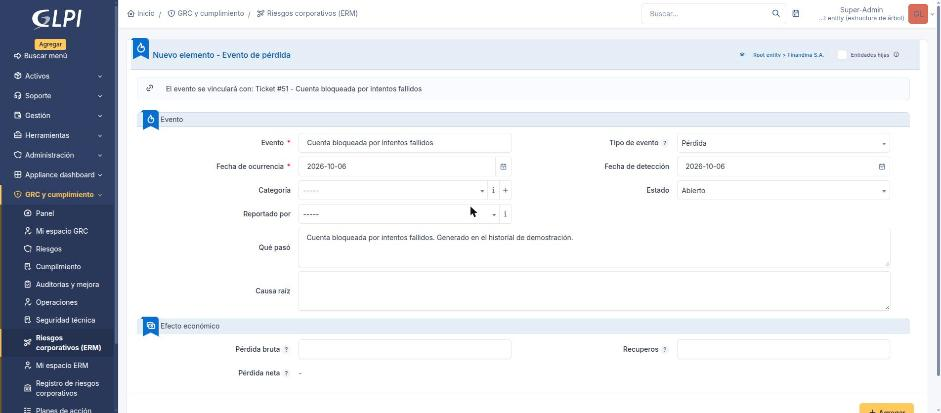
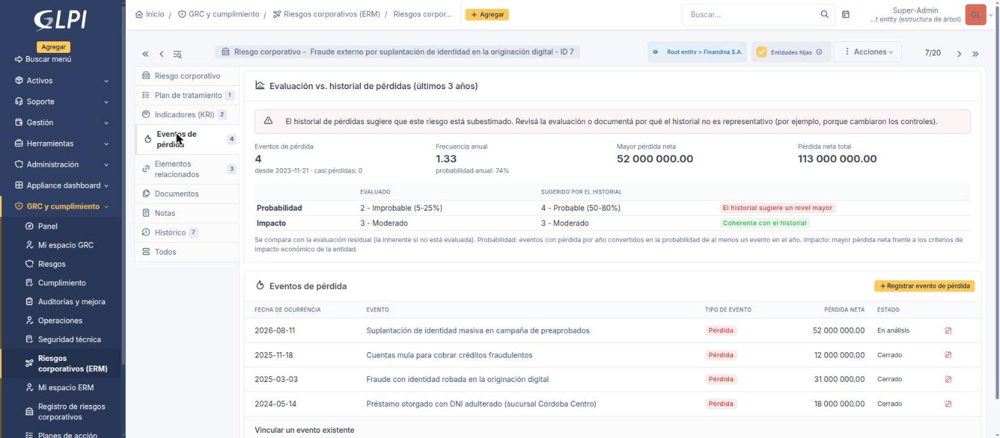
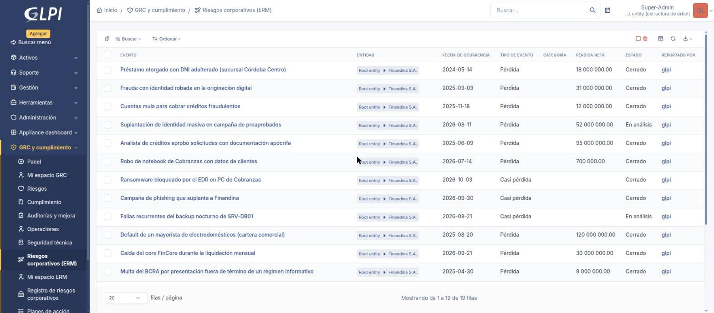
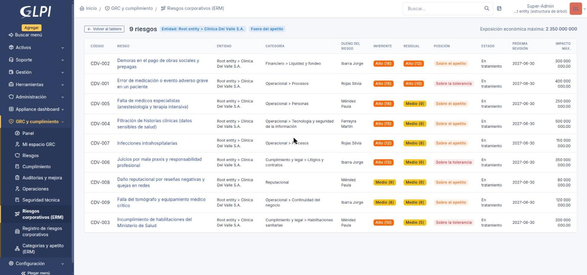

# Manual de usuario - ERM (Gestión de Riesgos Corporativos)

Versión del plugin: 2.0.x · GLPI 12

Este manual explica cómo usar el registro de riesgos corporativos día a día. La instalación y los permisos
están en la [guía de administración](guia-administracion.md).

## 1. Conceptos

| Concepto | Qué significa en el plugin |
|---|---|
| **Riesgo corporativo** | Evento incierto que puede afectar los objetivos de la organización (no sólo de TI). |
| **Categoría** | Clasificación jerárquica: Estratégico, Financiero, Operacional, Cumplimiento y legal, Fraude, Reputacional, ESG y climático. Se crea al instalar en el idioma de quien instala y se puede adaptar. |
| **Riesgo inherente** | Nivel del riesgo **sin** considerar los controles existentes. |
| **Riesgo residual** | Nivel del riesgo **después** de los controles existentes. Es el que se compara con el apetito. |
| **Apetito** | Nivel residual máximo que la organización **desea** asumir en una categoría. |
| **Tolerancia** | Nivel residual máximo **admisible**. Superarlo exige acción inmediata. |
| **Evento de pérdida** | Algo que ocurrió: un incidente con pérdida, una **casi pérdida** (ocurrió pero no costó) o una ganancia inesperada. Es la evidencia de que el riesgo se materializa. |
| **Riesgo propio** | Un riesgo del que sos dueño, de tu área, o donde tenés una acción o un indicador asignado. |

## 2. Dónde está

Menú **GRC y cumplimiento** (o **Gestión** si GRC Manager no está instalado):

- **Riesgos corporativos (ERM)**: tablero.
- **Mi espacio ERM**: mis acciones, mis indicadores y mis riesgos.
- **Mapa integral de riesgos**: riesgos corporativos, de seguridad de la información y de proveedores juntos.
- **Informe de Directorio**: informe en PDF y fotos trimestrales.
- **Registro de riesgos corporativos**: lista y búsqueda.
- **Planes de acción**: todas las acciones de tratamiento.
- **Eventos de pérdida**: base de incidentes con efecto económico, casi pérdidas y ganancias inesperadas.
- **Reportes recibidos**: reportes de riesgos e incidentes enviados por el personal (para el equipo de riesgos).
- **Sistemas de IA**: inventario de sistemas de inteligencia artificial y sus evaluaciones de impacto.
- **Categorías y apetito (ERM)**: taxonomía, apetito y tolerancia.

Lo que ves depende de tu perfil: con "ver propios" sólo aparecen tus riesgos, y un aviso lo indica en el tablero.

## 3. Escalas de evaluación (matriz 5×5)

**Probabilidad**: 1 Rara (< 5% anual) · 2 Improbable (5-25%) · 3 Posible (25-50%) · 4 Probable (50-80%) ·
5 Casi cierta (> 80%).

**Impacto**: 1 Insignificante · 2 Menor · 3 Moderado · 4 Mayor · 5 Catastrófico. Cada organización define los
umbrales económicos de cada nivel en su metodología (por ejemplo, en la declaración de apetito); considerá también el
impacto legal, reputacional y operativo, no sólo el económico. Los importes se cargan en la moneda de la organización.

**Nivel** = probabilidad × impacto: **1-4 Bajo**, **5-9 Medio**, **10-16 Alto**, **20-25 Crítico**.

## 4. Registrar un riesgo

1. **Registro de riesgos corporativos → Agregar**.
2. **Identificación**: nombre del riesgo (redactalo como evento: "Deterioro de la cartera por…"), categoría,
   dueño, área responsable, descripción, **causas** y **consecuencias**. El código se asigna solo con el prefijo de tu empresa (por ejemplo RC-001 o CDV-001).
3. **Evaluación inherente**: probabilidad e impacto sin controles. El nivel se calcula al guardar. Completá la
   velocidad de materialización y el impacto económico mínimo y máximo (acepta `1.500.000,50` o `1500000.5`, en la moneda de la organización).
4. **Controles existentes y riesgo residual**: describí los controles, su eficacia y la tendencia; luego
   probabilidad e impacto residuales. Si GRC Manager está instalado, la ficha muestra el resultado de la última
   prueba de los controles del SGSI vinculados al riesgo (directamente o a través de los riesgos del SGSI
   vinculados): si alguno falló, revisá la eficacia y el residual. Se muestra la **posición frente al apetito** de la categoría.
5. **Riesgo objetivo**: probabilidad e impacto que el plan de tratamiento tiene que alcanzar, y la fecha.
   Normalmente, dentro del apetito de la categoría.
6. **Tratamiento**: elegí la decisión (Mitigar, Transferir, Evitar, Aceptar), el estado, la justificación y las
   fechas de revisión.
7. **Guardar**.

## 5. Plan de tratamiento

Pestaña **Plan de tratamiento** del riesgo. Arriba, la **eficacia del tratamiento**: inherente → residual →
objetivo, el avance del plan (acciones cerradas) y el estado:

| Estado | Significado |
|---|---|
| Objetivo alcanzado | El residual ya está en el nivel objetivo o por debajo. |
| Tratamiento en curso | Quedan acciones abiertas. |
| Plan terminado sin alcanzar el objetivo | Todas las acciones se cerraron pero el residual no bajó: hay que revisar el plan o los controles. |
| Sobre el objetivo sin plan | El residual supera el objetivo y no hay acciones. |

- **Agregar**: descripción, responsable, vencimiento y costo estimado.
- **Actualizar**: cambiá el estado (Planificada, En curso, Realizada, Cancelada). Al marcar "Realizada" se
  completa la fecha si no la indicaste.
- Las acciones vencidas se resaltan en rojo y aparecen en el tablero.
- Un riesgo a **mitigar o transferir no se puede cerrar** sin al menos una acción.
- Cada acción tiene su propia ficha (descripción, responsable, vencimiento, estado, costo, comentarios e
  historial): hacé clic en la descripción.

**Planes de acción** (menú): reúne las acciones de todos los riesgos que podés ver, con el buscador de GLPI
(filtros por responsable, estado, vencimiento, entidad o nivel del riesgo; exportación a Excel/PDF; búsquedas
guardadas). Desde el tablero, "Ver todos los planes de acción" abre las acciones vencidas.

## 6. Indicadores clave de riesgo (KRI)

Pestaña **Indicadores (KRI)**:

1. **Nuevo indicador**: nombre, unidad, sentido ("mayor es peor" o "menor es peor"), umbral de alerta, umbral
   crítico y frecuencia.
2. **Registrar valor**: fecha, valor y comentario. El gráfico muestra las últimas 12 mediciones en verde
   (normal), naranja (alerta) o rojo (crítico).

Los KRI en alerta o críticos aparecen en el tablero.

**KRI automáticos**: al crear el indicador, elegí la fuente "Búsqueda guardada de GLPI" y una búsqueda guardada
propia (por ejemplo, incidentes abiertos de una categoría); quien administra la configuración del ERM puede usar
cualquier búsqueda visible. El valor es la cantidad de resultados: se mide solo según la
frecuencia (acción automática ermkri) o con **Medir ahora**.

## 7. Aceptación formal de un riesgo

Aceptar un riesgo es una decisión de la Dirección o del Comité de riesgos:

1. El dueño propone la decisión **Aceptar** con su justificación.
2. Un usuario con el permiso **Aceptación de riesgos** abre el riesgo, deja la decisión "Aceptar", cambia el
   estado a **Aceptado** y guarda.
3. El sistema registra automáticamente **quién y cuándo** aceptó.

**Validez**: la aceptación vale hasta la fecha "Aceptación válida hasta" (12 meses por defecto, la fija el Comité).
30 días antes el dueño recibe un aviso y el tablero la muestra en "Aceptaciones a renovar". Para renovarla, el Comité
extiende la fecha: queda registrada como una nueva aceptación.

Reglas: el **dueño no puede aceptar su propio riesgo**; sin el permiso, la opción "Aceptado" no aparece; revocar
una aceptación también requiere el permiso. El Comité sólo puede modificar la decisión, el estado, la
justificación y las fechas de revisión: la evaluación queda bloqueada.

## 8. Vincular con otros elementos

Pestaña **Elementos relacionados**: elegí el tipo (riesgo o proceso del SGSI, control, obligación, proveedor,
contrato, aplicación, equipo, proyecto, grupo, cambio) y el elemento. Desde esos objetos, la pestaña
**Riesgos corporativos** muestra el camino inverso. Ejemplo: el riesgo de ciberataque corporativo vinculado a los
riesgos de ransomware y phishing del SGSI.

## 9. Revisiones del riesgo

Pestaña **Revisiones**: cada revisión periódica (taller, comité) queda registrada como evidencia.

1. Si la evaluación cambió, actualizala primero en la pestaña principal.
2. En **Revisiones**, completá fecha, **conclusión** (evaluación confirmada, actualizada, escalada al Comité o
   propuesta para cierre), **participantes**, comentarios y la **próxima revisión**.
3. **Registrar revisión**: se guarda una foto de la evaluación de ese momento (inherente, residual, objetivo, estado
   y decisión). Las revisiones no se pueden modificar. La fecha de última y próxima revisión del riesgo se actualizan.

El gráfico **Evolución del riesgo** muestra cómo cambiaron el inherente, el residual y el objetivo en cada revisión.

## 10. Avisos por correo

Si el administrador activó las notificaciones de GLPI, el plugin avisa por correo:

- **Al asignarte un riesgo** como dueño, o **una acción de tratamiento** como responsable (no si te lo asignás vos).
- **Cuando se cumple una acción de tu riesgo** (si sos el dueño). Si era la última acción abierta, el aviso dice si
  el riesgo alcanzó su objetivo o si hay que revisar la evaluación o el plan.
- **Resumen diario** por riesgo, a su dueño y a los responsables de las acciones e indicadores involucrados:
  acciones vencidas o que vencen en 7 días, revisión vencida o en los próximos 14 días, residual sobre el apetito o
  la tolerancia, KRI en alerta o con medición pendiente, plan terminado sin alcanzar el objetivo y evaluación por
  debajo del historial de pérdidas. La misma alerta se repite como máximo una vez por semana.

Todo eso también está siempre a la vista en **Mi espacio ERM** y en el tablero.

## 11. Mapa integral e informe de Directorio

**Mapa integral de riesgos**: reúne los riesgos corporativos (ERM) con los de seguridad de la información y de
proveedores de GRC Manager (si está instalado y tenés acceso), contados por nivel, con la lista de riesgos altos y
críticos de todos los orígenes. El control de **coherencia** marca los riesgos corporativos evaluados por debajo de
los riesgos del SGSI o de proveedores vinculados: un riesgo corporativo los agrega, así que no debería ser menor.

**Informe de Directorio** (PDF): elegí con qué trimestre comparar y descargalo. Incluye resumen ejecutivo con la
variación, cambios del período (riesgos que subieron, bajaron, nuevos, que salieron o volvieron al apetito,
cerrados), mapa de calor residual, riesgos fuera del apetito, los diez principales, tratamiento, pérdidas y la
visión integral. Se genera para la entidad elegida en GLPI.

Las **fotos trimestrales** guardan la evaluación de todos los riesgos al comienzo de cada trimestre (acción
automática) y permiten comparar períodos. Quien tiene el permiso de configuración puede tomarla a mano.

## 12. Reportar un riesgo o un incidente

Cualquier persona puede reportar algo que salió mal, que casi sale mal o que podría salir mal. En la interfaz
simplificada está en el menú **Complementos → ERM**; en la interfaz estándar, en **Mi espacio ERM → Reportar un
riesgo o un incidente**. Se elige el tipo (pasó algo con pérdida, casi pasa, podría pasar), se describe y se envía.
En **Mis reportes** se sigue el estado: recibido, tomado en cuenta o cerrado sin acción (con el motivo).

El equipo de riesgos los revisa en **Reportes recibidos** y los registra como **evento de pérdida** (incidentes y
casi pérdidas) o como **riesgo corporativo** a evaluar, o los cierra explicando por qué. El tablero avisa cuántos
esperan revisión.

## 13. Sistemas de IA y evaluaciones de impacto

**Inventario** (menú **Sistemas de IA**): para cada sistema, su propósito y caso de uso, tipo (IA generativa, voz,
analítica, predicción, visión, decisión automática), despliegue y proveedor, modelo, dueño, datos personales o
sensibles, personas afectadas, supervisión humana y **clase según el AI Act** (mínimo, limitado, alto, prohibido).

**Evaluación de impacto** (pestaña del sistema, ISO/IEC 42001 6.1.4): para nueve dimensiones (sesgo, privacidad,
transparencia, seguridad, fiabilidad y alucinaciones, supervisión humana, uso indebido, impacto social, cumplimiento
legal) se puntúa el impacto del 1 al 5 con su fundamento. El **nivel general** sigue a la peor dimensión (y sube a
crítico con tres dimensiones significativas). Se cargan las mitigaciones, el impacto residual y la próxima
evaluación.

Circuito: **borrador → enviada a aprobación → aprobada o rechazada**. La aprueba alguien con el permiso "Aprobar
evaluaciones" (Comité de IA o de riesgos) **distinto del autor**; una evaluación aprobada no se modifica (se crea una
nueva). Desde una evaluación aprobada de nivel medio o superior, **Crear riesgo corporativo** registra el riesgo en
la categoría "Inteligencia artificial", vinculado al sistema.

**Brechas de gobierno** (en la ficha y en el tablero): sistemas en desarrollo o producción de riesgo limitado o alto
sin evaluación aprobada vigente, y prácticas prohibidas.

## 14. Eventos de pérdida e historial

La ISO 31000 pide que el análisis se apoye en información confiable. Los eventos de pérdida son esa evidencia.

**Registrar un evento**: menú **Eventos de pérdida → Agregar**, o mejor desde donde se gestionó: pestaña
**Eventos de pérdida → Registrar evento de pérdida** de un ticket, problema, cambio o riesgo. El formulario se
completa con los datos del origen (nombre, descripción, fecha, entidad) y el evento queda vinculado.

- **Tipo**: pérdida, casi pérdida o ganancia inesperada. Sólo las pérdidas cuentan para la probabilidad; las
  casi pérdidas muestran que el riesgo está activo.
- **Fechas** de ocurrencia (obligatoria) y de detección.
- **Pérdida bruta y recuperos** (seguros, reclamos). La **pérdida neta** se calcula sola.
- **Causa raíz**, para aprender del evento.
- Pestaña **Riesgos y elementos vinculados**: un evento puede materializar varios riesgos y estar asociado a
  varios tickets.

**Qué dice el historial** (pestaña **Eventos de pérdida** del riesgo):

- **Frecuencia anual**: eventos con pérdida de los últimos 3 años, dividido 3.
- **Probabilidad anual**: probabilidad de que ocurra al menos un evento en el año (1 − e^−frecuencia), llevada a
  la escala: 1 evento en 3 años ≈ 28% (Posible); 4 eventos en 3 años ≈ 74% (Probable).
- **Impacto sugerido**: la mayor pérdida neta frente a los **criterios de impacto económico** de la entidad.
- Se compara con la evaluación **residual**. Si el historial sugiere un nivel mayor, aparece una alerta: revisá
  la evaluación, o dejá documentado por qué el historial ya no es representativo (por ejemplo, se reforzaron los
  controles después de los eventos).

El sistema **sugiere**, no cambia la evaluación: la decisión es del dueño del riesgo.

**Análisis cuantitativo** (misma pestaña):

- **Pérdida esperada anual según la evaluación**: centro de la franja de probabilidad × centro del rango de impacto
  económico.
- **Pérdida esperada anual según el historial**: frecuencia anual × pérdida neta promedio de los eventos.
- **Simulación Monte Carlo**: 10.000 años simulados con la frecuencia observada y las pérdidas registradas; muestra
  la mediana, el **P90** (en 9 de cada 10 años la pérdida es menor) y el P99. Sirve para dimensionar seguros,
  previsiones o el apetito en dinero.

Si la pérdida esperada según el historial es mucho mayor que la de la evaluación, aparece un aviso.

## 15. Mi espacio ERM

Pantalla personal con lo que tenés que hacer:

- **Mis acciones pendientes**, ordenadas por vencimiento (en rojo las vencidas, en naranja las que vencen en
  los próximos 30 días). Podés cambiar el estado sin abrir el riesgo.
- **KRI a mi cargo**: último valor, **próxima medición** según la frecuencia y un campo para registrar el valor
  en el momento.
- **Riesgos a mi cargo** (como dueño o por tu área), con su nivel, la posición frente al apetito y la próxima
  revisión.

## 16. Tablero

- **Indicadores** por nivel residual y exposición económica máxima total.
- **Mapas de calor** inherente y residual: cada celda muestra cuántos riesgos y sus códigos (pasá el mouse para
  verlos todos). Comparar ambos mapas muestra el efecto de los controles.
- **Riesgos y exposición por categoría**.
- **Fuera del apetito**: riesgos residuales sobre el apetito (naranja) o sobre la tolerancia (rojo).
- **Top 10 residuales**, **acciones vencidas** y **KRI en alerta**.
- **Todos los números se pueden cliquear**: las tarjetas por nivel, cada celda de los mapas de calor, cada
  categoría, los contadores por entidad, "fuera del apetito" y "KRI en alerta" abren la lista de los riesgos que
  hay detrás, con el filtro aplicado a la vista y un botón para volver al tablero.

- **Evaluación vs. historial de pérdidas**: los riesgos cuya evaluación es menor que lo que sugiere su historial,
  y las pérdidas netas de los últimos 12 meses.
- **Eficacia del tratamiento**: cuántos riesgos alcanzaron el objetivo, están en curso, terminaron el plan sin
  alcanzarlo o están sobre el objetivo sin plan ("Ver riesgos a atender" abre la lista).
- **Riesgos por entidad**: si tu perfil ve varias empresas, una tabla compara sus indicadores; el nombre de cada
  entidad lleva al registro filtrado. Para trabajar sobre una sola empresa, elegila en el selector de entidad de GLPI.

## 17. Categorías y apetito

**Categorías y apetito (ERM)** (requiere el permiso de configuración para modificar): cada categoría tiene
apetito, tolerancia y declaración de apetito por defecto. Si una subcategoría no los define, **hereda** los de la
superior. Cada empresa puede ajustarlos en la pestaña "Riesgos corporativos (ERM)" de su entidad.
Cambiar el apetito actualiza inmediatamente la posición de todos los riesgos de esa categoría.

## 18. Buenas prácticas

- Revisá cada riesgo al menos una vez al año (campo "Próxima revisión") y siempre ante un cambio relevante.
- Un riesgo sobre la tolerancia debe tener un plan de tratamiento con fechas, o una aceptación formal justificada.
- Registrá **todos** los eventos, también las casi pérdidas: sin datos, la probabilidad es sólo una opinión.
- Usá los KRI para anticipar: un indicador que se acerca al umbral de alerta es una señal para el dueño.
- Los riesgos de seguridad de la información se gestionan en detalle en el SGSI (GRC Manager); en el ERM,
  vinculalos a un riesgo corporativo agregado (por ejemplo, "Ciberataque con paralización del negocio").
